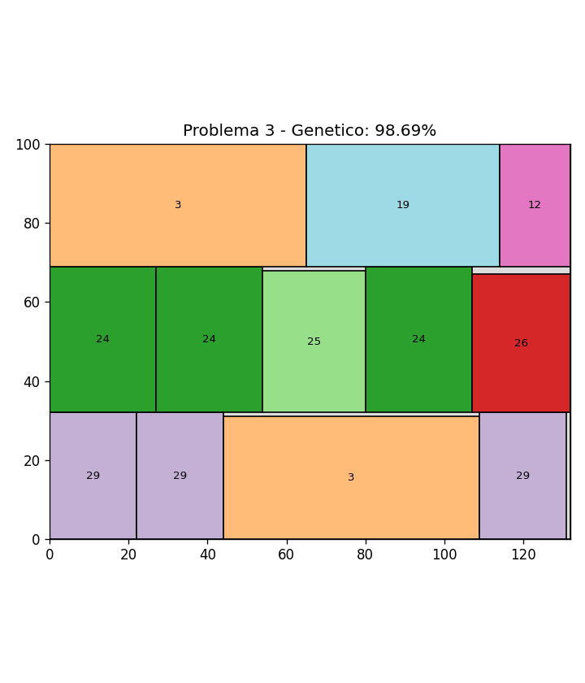

# Corte 2D por etapas: GRASP + Búsqueda Tabú vs. Algoritmo Genético

Trabajo del **Máster en Planificación y Gestión de Procesos Empresariales** (Universitat de València) · Caso III  
**Autoras:** Laura Montoliu Peris y Aya Limouri Hazzaf · **Profesor:** Ramón Álvarez-Valdés



## El problema
Tenemos una lámina de dimensiones conocidas y un conjunto de tipos de piezas rectangulares, cada uno con
sus dimensiones y un número máximo de unidades a cortar. El objetivo es **maximizar el área de las piezas
cortadas** sin superar el máximo de cada tipo. No se permite rotar las piezas.

El corte es **guillotina en dos etapas**:
1. Cortes horizontales de borde a borde → franjas.
2. Cortes verticales dentro de cada franja → piezas.

Trabajamos el **caso inexacto (con recorte)**: se permite un tercer corte para ajustar la altura de la pieza,
de modo que piezas de distinta altura pueden compartir franja.

Es un problema NP-hard, habitual en industrias como la del vidrio, la madera o el metal.

## Qué pedía el trabajo y qué hicimos
| Enunciado | Solución |
|---|---|
| a) Diseñar y programar una metaheurística para el caso inexacto | Dos metaheurísticas en Python: GRASP + Búsqueda Tabú y Algoritmo Genético |
| b) Aplicarla a los problemas del anexo | Tres instancias resueltas y comparadas (tabla de resultados) |
| c) Proponer una formulación lineal entera | Modelo de Programación Lineal Entera (ver abajo) |

## a) Metaheurísticas

### GRASP + Búsqueda Tabú (`grasp_tabu.py`)
- **Construcción GRASP:** en cada paso se forma una lista restringida de candidatos (RCL) con las piezas de mayor área (α = 0,8) y se elige una al azar. Se coloca en una franja existente o se abre una nueva.
- **Mejora con Búsqueda Tabú:** rellena los huecos que deja GRASP con el mejor movimiento de inserción, usando lista tabú y criterio de aspiración.
- 5.000 iteraciones por problema.

### Algoritmo Genético (`algoritmo_genetico.py`)
- **Individuo:** permutación del orden de colocación de todas las piezas.
- **Decodificación:** convierte la permutación en un patrón de corte factible por franjas.
- **Fitness:** porcentaje de aprovechamiento de la lámina.
- **Operadores:** selección por torneo (k = 3), cruce OX adaptado a piezas repetidas, mutación por intercambio (p = 0,4) y elitismo.
- Población de 200 individuos × 700 generaciones.

## b) Resultados

| Problema | Lámina | Tipos | Piezas | GRASP-TS | Algoritmo Genético |
|---|---|---|---|---|---|
| 1 | 40 × 70 | 10 | 23 | 87,46 % | **90,54 %** |
| 2 | 50 × 60 | 20 | 63 | 98,33 % | 98,33 % |
| 3 | 132 × 100 | 30 | 71 | 95,80 % | **98,69 %** |
| **Media** | | | | 93,86 % | **95,85 %** |

**Conclusiones**
- El Algoritmo Genético obtiene mejor media y gana en 2 de los 3 problemas.
- La ventaja no se debe solo al número de iteraciones: con 700.000 iteraciones el GRASP-TS obtiene prácticamente los mismos resultados que con 5.000.
- El GRASP-TS es más rápido; el genético explora mejor combinaciones de piezas.

## c) Formulación lineal entera
**Variables**
- `x_ik` ∈ ℤ⁺: número de piezas del tipo *i* en la franja *k*
- `y_k` ∈ {0,1}: se utiliza la franja *k*
- `h_k` ≥ 0: altura de la franja *k*
- `z_ik` ∈ {0,1}: la pieza *i* está en la franja *k*

**Objetivo:** maximizar el área cortada, Σᵢ Σₖ aᵢ · x_ik

**Restricciones:** ancho de cada franja, disponibilidad máxima de piezas, altura total de la lámina,
altura de la pieza ≤ altura de su franja (caso inexacto) y activación entre variables.

## Cómo ejecutarlo
```bash
pip install matplotlib
python grasp_tabu.py
python algoritmo_genetico.py
```
Cada script resuelve los tres problemas, muestra el aprovechamiento y guarda las imágenes de los patrones de corte.

## Referencias
- Álvarez-Valdés, R., Parajón, A. y Tamarit, J.M. (2002). *A tabu search algorithm for large-scale guillotine (un)constrained two-dimensional cutting problems.* Computers & Operations Research, 29, 925–947.
- Álvarez-Valdés, R., Martí, R., Parajón, A. y Tamarit, J.M. (2007). *GRASP and path relinking for the two-dimensional two-stage cutting-stock problem.* INFORMS Journal on Computing, 19(2), 261–272.
- Feo, T. y Resende, M.G.C. (1995). *Greedy randomized adaptive search procedures.* Journal of Global Optimization, 6(2), 109–133.
- Holland, J.H. (1975). *Adaptation in Natural and Artificial Systems.* University of Michigan Press.
